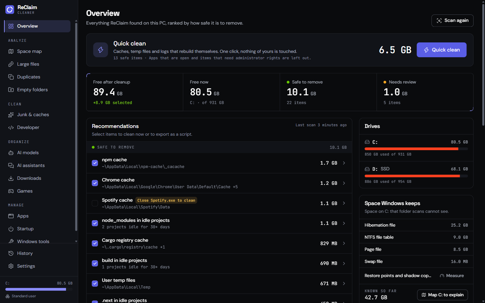
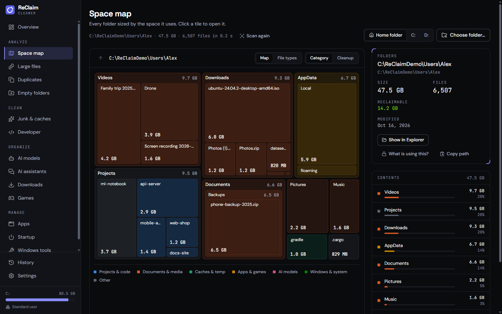
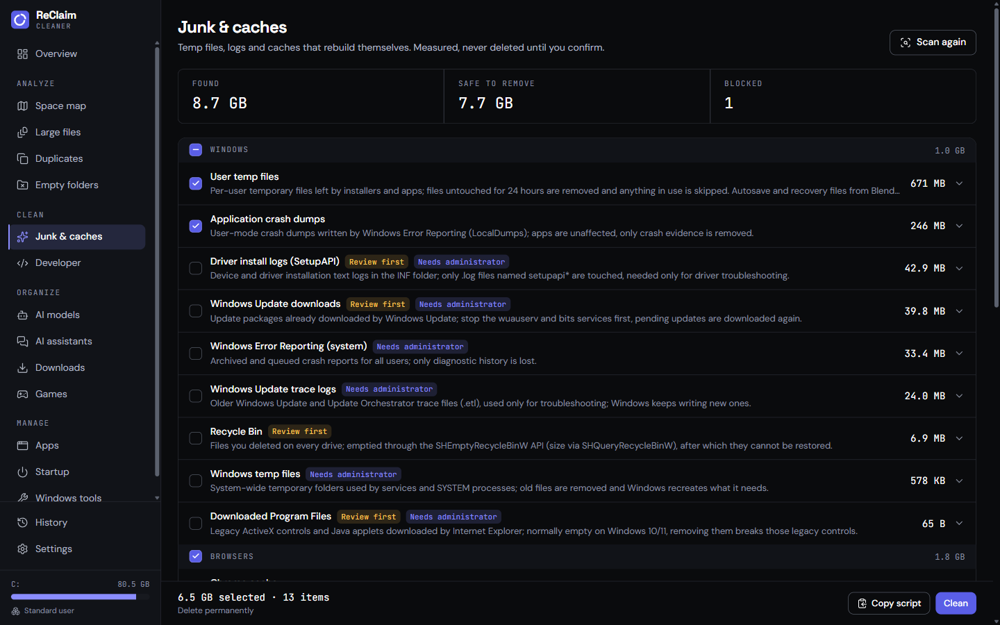
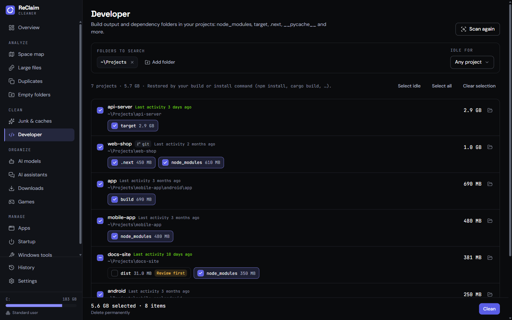
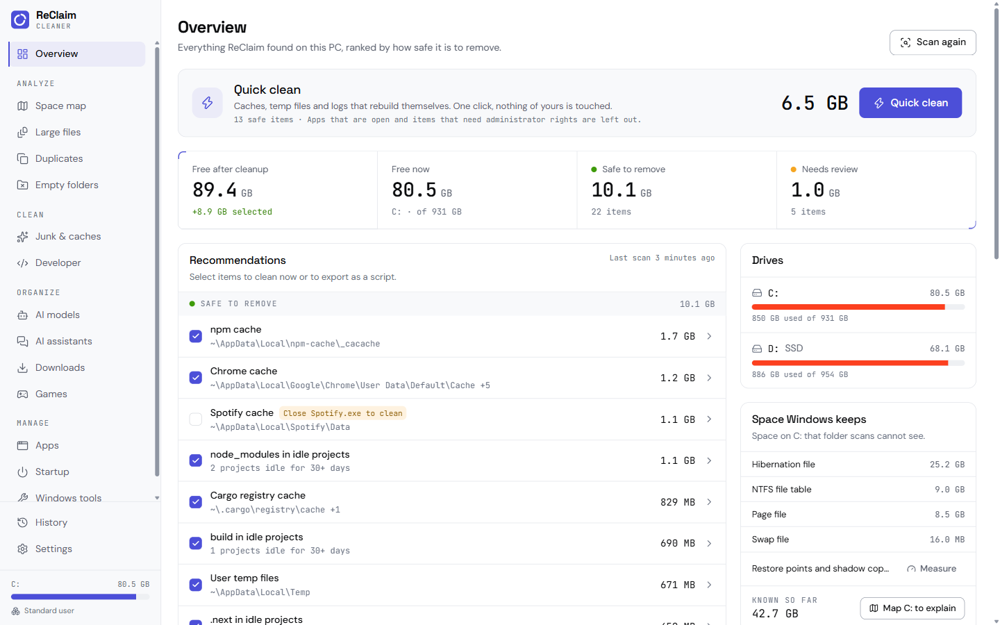
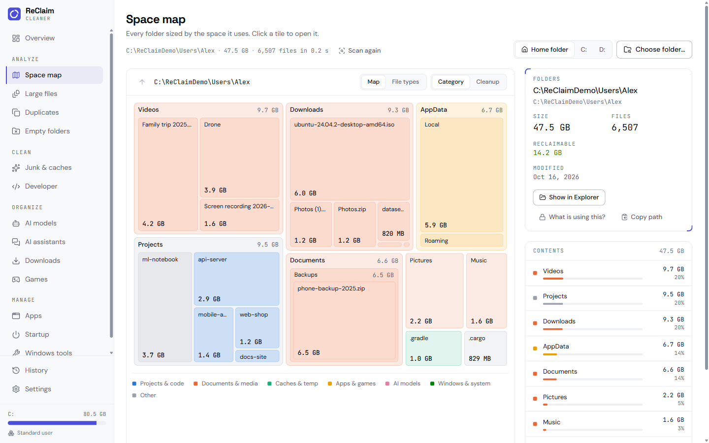

<div align="center">


# ReClaim Cleaner

**See where your disk space went. Reclaim it without breaking anything.**

An open-source disk cleaner and space analyzer. It finds the reclaimable
gigabytes, ranks every one of them by how safe it is to remove, and deletes
nothing until you have looked at the list.

[](https://go.dev)
[](https://github.com/egoist/mygo)
[](./LICENSE)
[](#install)
[](#testing)

[Why ReClaim](#why-reclaim) · [Screenshots](#screenshots) · [Features](#features) · [Safety model](#safety-model) · [Install](#install) · [Build](#build-and-run) · [Architecture](#architecture) · [Credits](#credits)

</div>

---

## Why ReClaim

Every disk fills up, and no two tools agree on what is safe to delete. A cache
you can rebuild and a folder you will never see again look the same to `rm`.

ReClaim Cleaner draws the line first and deletes second:

- **Nothing is deleted unseen.** A scan only measures. Every clean runs from a
  list you have already read, with sizes and risk levels next to each row.
- **Three risk levels, enforced in the engine.** *Safe* caches are preselected;
  *review* items are listed but not selected; *caution* items stay hidden until
  you turn them on. The UI cannot promote an item past its own risk.
- **Protected paths are protected.** Drive roots, system folders, Program
  Files, your profile and library folders, OneDrive and `.git` folders can never
  be removed — not by a rule, not by hand.
- **Links are never followed.** A junction or symlink inside a cache is removed
  as a link or skipped, so it cannot redirect a delete somewhere else.
- **The reason is always visible.** Every row says what it is and how it comes
  back: "restored with an install command", "rebuilt by `cargo build`".

## Screenshots

**Overview.** Free space now and after cleanup, the reclaimable total split by
risk, and one list of recommendations you can clean or export:

[](./docs/screenshots/overview-dark.png)

**Space map.** A treemap of any drive or folder, coloured by category. The
Cleanup view paints only what you can reclaim:

[](./docs/screenshots/explorer-dark.png)

**Junk and caches.** 233 known locations across Windows, browsers, apps, game
launchers and developer toolchains:

[](./docs/screenshots/junk-dark.png)

**Developer.** Every project on your disk with its rebuildable folders already
selected, and an "idle" filter for the ones you have not touched in 30 days:

[](./docs/screenshots/projects-dark.png)

Light theme is a first-class palette, not an afterthought:

| Overview | Space map |
| --- | --- |
| [](./docs/screenshots/overview-light.png) | [](./docs/screenshots/explorer-light.png) |

> Screenshots are from the interface this build ships. Some panels are
> Windows-only; the sections below say which.

## Features

### Analyze

- **Space map** — a treemap of a drive or folder, sized by bytes and coloured by
  category: projects, media, caches, apps, AI models, Windows. A Cleanup view
  repaints it to show only reclaimable space.
- **Hidden space** — when a drive holds more than its folders add up to, the map
  says where the rest is: restore points and shadow copies, reserved storage,
  the page and hibernation files, the NTFS file table, WSL and Docker disks, and
  folders that could not be read. Each part links to the screen that manages it.
- **Large files** — filter by type and age, sorted by size.
- **Duplicates** — confirmed with a full BLAKE3 hash; hard links are counted
  once, so the same file is never shown as its own duplicate.
- **Empty folders** — the leaves first, so emptying one does not orphan another.

### Clean

- **Junk and caches** — 233 known locations: temp files and logs, crash dumps,
  browser caches (Chrome, Edge, Brave, Firefox and more), app caches (Discord,
  Slack, Teams, VS Code, Spotify), game launchers, and developer caches (npm,
  pnpm, pip, uv, Cargo, Gradle, NuGet, Go, Playwright).
- **Developer** — finds `node_modules`, `target`, `.next`, `__pycache__`,
  `.venv` and 40 other build folders inside your projects. Each project is
  listed with its rebuildable folders selected.
- **Quick clean** — one confirmation clears every safe cache, temp file and log.

### Organize

- **AI models and assistants** — every model in Hugging Face, LM Studio, Ollama
  and ComfyUI in one list, with copies stored by two tools flagged; plus the
  sessions, checkpoints and logs kept by Claude Code, Codex and Gemini CLI.
- **Downloads** — your Downloads folder by type and age, with thumbnails and
  browser re-downloads such as `file (1).pdf` flagged.
- **Games** — every Steam library and the shader cache of each game, named after
  the game. Caches of games you removed are preselected.
- **Apps and startup** — real app icons, uninstall Desktop and Store apps with
  their own uninstaller, review leftover folders scored by confidence, and turn
  startup apps off the way Task Manager does (reversibly).

### The app

- **14 languages** — English, Turkish, German, Spanish, French, Italian,
  Portuguese (Brazil), Polish, Russian, Ukrainian, Indonesian, Japanese, Korean
  and Simplified Chinese.
- **Light and dark theme**, portable mode, and a local cleanup history.
- **A native shell** — the window, the file pickers and the "reveal in file
  manager" calls go through Go, not a browser sandbox.

## Safety model

These rules live in the engine, not only in the UI:

1. **Preview first.** Scans never delete. Every clean runs from a list you have
   seen, with sizes and risk levels.
2. **Three risk levels.** *Safe* items are preselected, *review* items are shown
   but not selected, *caution* items stay hidden until enabled in Settings.
3. **Protected locations.** Drive roots, system folders, Program Files, your
   profile and library folders, OneDrive, `.git` folders and the app's own data
   can never be removed. Your exclusions apply everywhere.
4. **Links are never followed.** Junctions and symbolic links are removed as
   links or skipped. Online-only cloud files are never opened or downloaded.
5. **Commands are copied, not run.** System areas that have no safe delete are
   measured, and the official command is shown for you to copy.

## Install

Prebuilt apps are on the [releases page](https://github.com/agnogad/ReClaim-Cleaner/releases):

| Platform | Download |
| --- | --- |
| **Linux** | `reclaim-cleaner-<version>-linux-<arch>.tar.gz` (unpacks with `install.sh`), or the `.deb` |
| **macOS** | `reclaim-cleaner-<version>.dmg` (universal: Apple silicon and Intel) |
| **Windows** | `reclaim-cleaner-setup-<version>-<arch>.exe` |

Verify a download against the release's `SHA256SUMS`.

```bash
# Linux, from the tarball
tar xzf reclaim-cleaner-0.5.0-linux-amd64.tar.gz
./install.sh          # installs under ~/.local and adds a menu entry
```

### Platform support

The engine began life as a Windows tool and is being ported outward. This build
is honest about the state of each platform:

| Area | Linux | macOS | Windows |
| --- | --- | --- | --- |
| Space map, Large files, Duplicates, Empty folders | ✅ | ✅ | ✅ |
| Junk and caches, Developer | ✅ | ✅ | ✅ |
| AI models, AI assistants, Downloads, Games | ✅ | ✅ | ✅ |
| Apps, Startup, Windows tools, Hidden space | — | — | ✅ |
| Free space query, mounted drives | ✅ | ✅* | — |

\* macOS support for the mount table is new; report anything that looks wrong.

On Linux the app deletes only inside your home folder and refuses to start a
clean as root. Windows-only panels are hidden rather than shown broken.

## Build and run

### Requirements

- **Go 1.27+**
- **Bun** for the frontend
- The system webview: WebKitGTK 4.1 on Linux, WebView2 on Windows, WKWebView on
  macOS. MyGo needs no cgo, so every platform cross-compiles from any machine.

### From source

```bash
git clone https://github.com/agnogad/ReClaim-Cleaner.git
cd ReClaim-Cleaner
bun install
bun install --cwd frontend
bun run build          # frontend/dist, which main.go embeds
go run .
```

`go build` on its own works too: `main.go` embeds `frontend/dist` with
`//go:embed`, so the built binary carries the page and needs no dev server and
no `MYGO_FRONTEND_DIST`.

### A packaged app

```bash
bunx mygo build -platform linux/amd64,windows/amd64,darwin/universal
```

The version comes from `version` in `mygo.config.ts`; the release workflow sets
it from the tag, so a `v0.6.0` tag publishes a `0.6.0` build. Linux gets a
`.deb`, a `.tar.gz` with `install.sh` and a `PKGBUILD`; Windows an NSIS
installer; macOS a universal `.app` in a `.dmg`.

## Testing

```bash
go test ./...          # the engine and the Tauri-compatible bridge
go vet ./...           # static checks
gofmt -l .             # formatting

bun run --cwd frontend typecheck
bun run --cwd frontend test   # 124 tests
```

The Go suite covers path protection, rule expansion, the mount table and the
bridge's argument handling. The frontend suite covers the i18n catalogue (every
language has every key, and the platform rules hold), the store, and the
formatting helpers.

## Architecture

```
main.go ── mygo.BindAs("Reclaim") ──────────────┐
  │  one Call(cmd, args) for every Tauri command│
  ▼                                             ▼
internal/bridge        internal/engine
  Tauri command names    the file system, the mount table,
  → typed Go calls       the rules, the scans, the cleans
  events, dialogs,
  opener, reveal
```

- **`internal/engine`** — everything that touches the disk, ports the Rust crate
  `reclaim-core` and keeps its semantics, its safety rules and its vocabulary
  (`Risk`, `Group`, `Mode`, `DeleteMethod`). It never imports the UI.
- **`internal/bridge`** — the compatibility layer. The frontend is the original
  Tauri/React app, so it still calls `invoke("junk_scan", …)` and listens for
  `reclaim:progress`. The bridge answers those names with Go calls and turns
  `mygo` events back into the payloads the page expects.
- **The frontend** — React, Tailwind and Zustand, unchanged apart from the
  transport. All UI code lives under `frontend/src`.

Because the frontend was the point of the port, it stayed a web app: the Go side
replaces Tauri, not React.

### Platform files

The engine reads the Unix mount table, so the parts that cannot cross compile
are split by build tag:

```
internal/engine/mounts_unix.go     linux || darwin   StatFSOf, DeviceOf
internal/engine/size_unix.go       linux || darwin   allocatedSize from st_blocks
internal/engine/mounts_windows.go  windows           refuses, with a reason
internal/engine/size_windows.go    windows           logical size
```

That is why `GOOS=windows go build ./...` succeeds and all five targets are
checked in CI.

## Repository layout

```
gocleaner/
├─ main.go               the window, the event shim, the service binding
├─ mygo.config.ts        name, version, build command, output
├─ internal/
│  ├─ engine/            the port of reclaim-core: scans, rules, cleans
│  └─ bridge/            Tauri command names → Go, and events back
├─ frontend/
│  ├─ src/               React app: views, store, i18n, lib
│  ├─ public/icon.svg
│  └─ dist/              built page, embedded by main.go
├─ rules/
│  ├─ artifacts.json     42 build-folder rules (node_modules, target, …)
│  ├─ targets.json       233 junk and cache locations
│  └─ linux/             the Linux rule set
├─ src/                  the upstream Tauri project, for reference
└─ .github/workflows/    CI and the cross-platform release
```

## Design principles

- **Measure, then ask, then delete.** Three separate steps, in that order,
  every time.
- **The engine owns safety.** A rule cannot mark itself safe past the guard that
  protects a path; the UI is a view, not an authority.
- **Be honest about the port.** A platform that cannot answer a question says
  so, instead of returning a zero that looks like an answer.
- **Keep the frontend the frontend.** The Tauri contract is thin enough to
  reimplement; the React app did not need rewriting to run on Go.

## Contributing

Issues and pull requests are welcome. Before opening a PR:

1. Run `gofmt -l .`, `go vet ./...`, `go test ./...`, and the frontend's
   `typecheck` and `test`.
2. Make sure `GOOS=windows go build ./...` still passes.
3. Any new junk rule needs a risk level, an English description, and a
   `descriptionTr` — the rule files are read by the UI, not compiled in.

## Credits

ReClaim Cleaner is a Go port of
**[reclaim-cleaner](https://github.com/yusufky63/reclaim-cleaner)** by
[yusufky63](https://github.com/yusufky63): its engine, its rule sets and its
React frontend are reused under the MIT licence. Built with
**[MyGo](https://github.com/egoist/mygo)**, which replaces the original Tauri
shell.

## License

Released under the [MIT License](./LICENSE). Copyright © 2026 yusufky63 and
contributors.

<div align="center">

Your disk, measured before it is touched.

</div>
